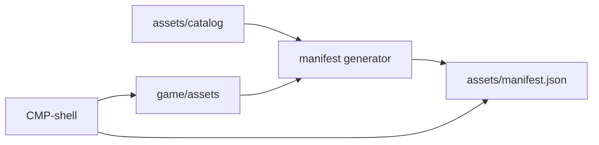

# Asset Access (Technical)

Authoring rules: [`.agents/specs/rules/technical/asset-access.md`](../../.agents/specs/rules/technical/asset-access.md).

- **Serves**: Product access rules for fonts, SFX, music, and puzzle pictures ([`ACC`](../assets/access.md)); offline local pack ([`definition.md`](../definition/definition.md)).
- **Informed by**: [`specs/assets/access.md`](../assets/access.md); [`assets.md`](../assets/assets.md)
- **ADRs**: [ADR-0001](../adr/decisions/0001-godot-gdscript.md), [ADR-0003](../adr/decisions/0003-catalog-asset-roots.md)

## Resolution

| ID | Aspect | Realizes | Rule |
|----|--------|----------|------|
| R1 | Asset manifest | `ACC.A2` | Generated by `asset_manifest.py` under `.github/scripts/` ([ADR-0006](../adr/decisions/0006-asset-manifest-generator.md)), locally in the change and in the asset CI job on every catalog or asset-path change. JSON at `assets/manifest.json`. Maps each approved asset ID to one or more `res://` paths under `game/assets/`. CI fails when the committed manifest differs from a regenerated one |
| R2 | Resolver | `ACC.A1` | [`CMP-shell`](components/shell.md) is the only runtime reader of the manifest |
| R3 | Unresolved asset ID | `ACC.A3` | Dev: loud fail / assert on resolve. Release: build fails if the manifest lists a missing, draft, or deprecated ID used by shipped code |

## Engine resources

| ID | Resource class | Lives in | Uses | Kept in step by |
|----|----------------|----------|------|-----------------|
| E1 | Godot scenes, Theme / font users, AudioStream players | Under `game/`, outside `game/assets/` | G1–G3 asset IDs via the resolver | Runtime resolve only; no baked file paths in game logic |

## Build outputs

| ID | Output | Generator | Inputs | Location | Committed |
|----|--------|-----------|--------|----------|-----------|
| O1 | None — no generated build outputs. Godot `.import` sidecars stay with their source files in the asset root, as [`ACC.P1`](../assets/access.md) allows | Godot import | `ACC.G1`–`G3` | `game/assets/` | Rebuilt by the editor / export; sidecars may be committed with source files |

## Load groups

| ID | Realizes | Mechanism | Owner | Sequence |
|----|----------|-----------|-------|----------|
| G1 | `ACC.G1` | Preload at app start | [`CMP-shell`](components/shell.md) | Load at app start; no unload |
| G2 | `ACC.G2` | Stream or preload bed with gallery/puzzle; sting one-shot on result | [`CMP-shell`](components/shell.md) | Load with gallery/puzzle; sting on result; mute bed only per settings |
| G3 | `ACC.G3` | On-demand resolve by puzzle identity | [`CMP-shell`](components/shell.md) | Resolve generated and pixel picture ids; unload when unused |

## Diagram

