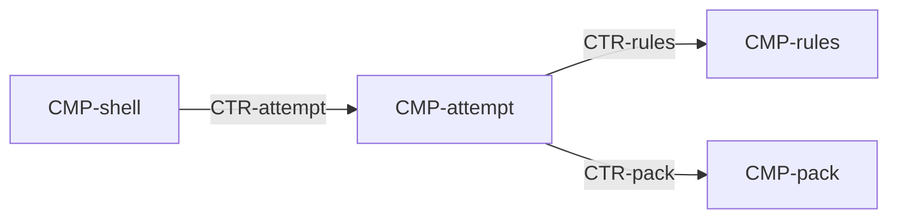

# Component: Attempt

Authoring rules: [`.agents/specs/rules/technical/components.md`](../../../.agents/specs/rules/technical/components.md).

- **Layer**: [L2](../layers.md) Play
- **Module**: [M2](../modules.md) play
- **Serves**: The solve loop and end conditions ([`loops/solve.md`](../../design/loops/solve.md), [`end-conditions.md`](../../design/end-conditions.md))
- **Informed by**: [`game-state.md`](../../design/game-state.md), [`entities/clue.md`](../../design/entities/clue.md), [`progression.md`](../../design/progression.md)
- **ADRs**: [ADR-0001](../../adr/decisions/0001-godot-gdscript.md)

## Responsibilities

| ID | Responsibility |
|----|----------------|
| R1 | Own the open puzzle: mark grid, elapsed, paused, and marks-allowed |
| R2 | On open, load the definition and progress, block marks through get-set-ready, then apply empty-line auto-cross |
| R3 | Tick elapsed only while marks are allowed and the puzzle is not paused |
| R4 | After an accepted mark, ask the rules whether the fill set is solved |
| R5 | Commit when marks or attempt status change, and on pause. On solve or leave, update the pack, then clear the open attempt |

## Communication

| ID | Peer | Direction | Via contract | Notes |
|----|------|-----------|--------------|-------|
| C1 | [`CMP-shell`](shell.md) | both | [`CTR-attempt`](../contracts/attempt.md) | Shell calls. Attempt emits solved and left |
| C2 | [`CMP-rules`](rules.md) | calls | [`CTR-rules`](../contracts/rules.md) | Is-solved, line status, and auto-cross cells |
| C3 | [`CMP-pack`](pack.md) | calls | [`CTR-pack`](../contracts/pack.md) | Definition, progress, commit, and record-solve |

## Owns / mutates

| Schema or state | Access |
|-----------------|--------|
| [`SCH-attempt`](../schemata/attempt.md) | writes |
| [`SCH-mark-grid`](../schemata/mark-grid.md) | writes |

## Diagram

## Failure / concurrency / persistence

N/A — the shell calls this component on one main thread. Durable fields are written through [`CTR-pack`](../contracts/pack.md) ([`persistence.md`](../persistence.md)).
