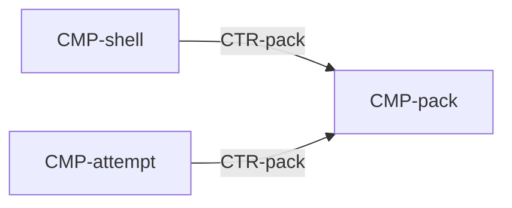

# Component: Pack

Authoring rules: [`.agents/specs/rules/technical/components.md`](../../../.agents/specs/rules/technical/components.md).

- **Layer**: [L3](../layers.md) Records
- **Module**: [M3](../modules.md) records
- **Serves**: The 200-puzzle local pack and durable progress ([`entities/puzzle.md`](../../design/entities/puzzle.md), [`progression.md`](../../design/progression.md))
- **Informed by**: [`end-conditions.md`](../../design/end-conditions.md), [`game-state.md`](../../design/game-state.md), [`persistence.md`](../persistence.md)
- **ADRs**: [ADR-0001](../../adr/decisions/0001-godot-gdscript.md), [ADR-0002](../../adr/decisions/0002-user-data-dir.md), [ADR-0004](../../adr/decisions/0004-shell-attempt-rules-pack.md)

## Responsibilities

| ID | Responsibility |
|----|----------------|
| R1 | Hold the 200 puzzle definitions and one progress record each |
| R2 | Serve the gallery list, completion rate, definitions, and progress |
| R3 | Apply commit, record-solve, and reset |
| R4 | Load and replace `user://progress.cfg`. A failed write leaves the previous file |
| R5 | Load, validate, and reject entries from `res://data/pack.json` into definitions ([`CTR-pack`](../contracts/pack.md) O8); no progress file is written |

## Communication

| ID | Peer | Direction | Via contract | Notes |
|----|------|-----------|--------------|-------|
| C1 | [`CMP-shell`](shell.md) | listens | [`CTR-pack`](../contracts/pack.md) | List, completion rate, reset, and both picture ids |
| C2 | [`CMP-attempt`](attempt.md) | listens | [`CTR-pack`](../contracts/pack.md) | Definition, progress, commit, and record-solve |

## Owns / mutates

| Schema or state | Access |
|-----------------|--------|
| [`SCH-puzzle-def`](../schemata/puzzle-def.md) | writes at load from the export ([`CTR-pack`](../contracts/pack.md) O8) |
| [`SCH-progress`](../schemata/progress.md) | writes |

## Diagram

## Failure / concurrency / persistence

Persistence: [`persistence.md`](../persistence.md) M1–M2 ([ADR-0002](../../adr/decisions/0002-user-data-dir.md)). N/A — no separate failure or concurrency spec. The shell and the attempt call this component on one main thread.
