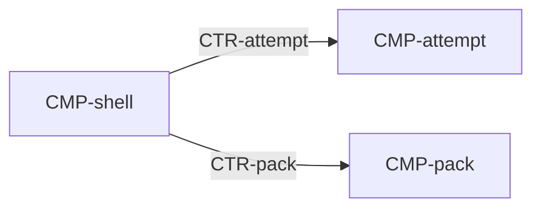

# Component: Shell

Authoring rules: [`.agents/specs/rules/technical/components.md`](../../../.agents/specs/rules/technical/components.md).

- **Layer**: [L1](../layers.md) Presentation
- **Module**: [M1](../modules.md) presentation
- **Serves**: Gallery, puzzle, result, and settings ([`ux.md`](../../ux/ux.md))
- **Informed by**: [`screens/gallery.md`](../../ux/screens/gallery.md), [`screens/puzzle.md`](../../ux/screens/puzzle.md), [`screens/result.md`](../../ux/screens/result.md), [`screens/settings.md`](../../ux/screens/settings.md), [`haptics.md`](../../view/haptics.md), [`audio.md`](../../view/audio.md)
- **ADRs**: [ADR-0001](../../adr/decisions/0001-godot-gdscript.md), [ADR-0003](../../adr/decisions/0003-catalog-asset-roots.md)

## Responsibilities

| ID | Responsibility |
|----|----------------|
| R1 | Show the gallery, the open puzzle, the result, or settings |
| R2 | Send open, mark, advance, pause, resume, and leave to the attempt |
| R3 | Draw the grid, clues, line cues, and the result fades. Request each stored picture by asset id when the gallery or result shows it |
| R4 | Play the bed, mark ticks (fill/cross/clear), the solve sting, and the haptic click |
| R5 | Hold session preferences: haptics default on, music mute default off |
| R6 | Read `assets/manifest.json` and resolve asset IDs for G1–G3 ([ADR-0003](../../adr/decisions/0003-catalog-asset-roots.md)) |

## Communication

| ID | Peer | Direction | Via contract | Notes |
|----|------|-----------|--------------|-------|
| C1 | [`CMP-attempt`](attempt.md) | both | [`CTR-attempt`](../contracts/attempt.md) | Calls operations. Listens for ready, solved, and left |
| C2 | [`CMP-pack`](pack.md) | calls | [`CTR-pack`](../contracts/pack.md) | List, completion rate, reset, and both picture ids |

## Owns / mutates

| Schema or state | Access |
|-----------------|--------|
| [`SCH-preferences`](../schemata/preferences.md) | writes |

## Diagram

## Failure / concurrency / persistence

N/A — no failure, concurrency, or persistence spec applies. Rejected calls change nothing on the contracts. Preferences last for the session.
