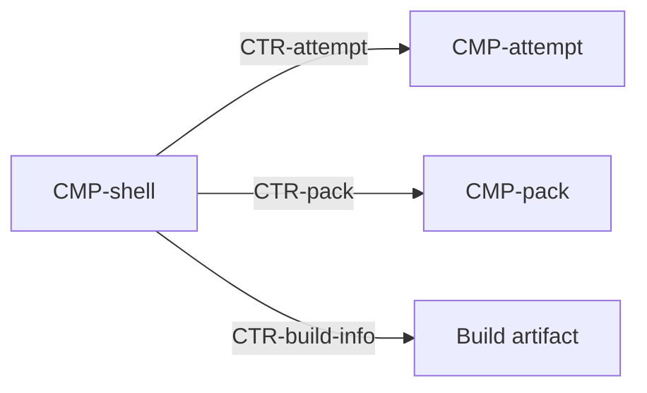

# Component: Shell

Authoring rules: [`.agents/specs/rules/technical/components.md`](../../../.agents/specs/rules/technical/components.md).

- **Layer**: [L1](../layers.md) Presentation
- **Module**: [M1](../modules.md) presentation
- **Serves**: Main menu, gallery, puzzle, result, and settings ([`ux.md`](../../ux/ux.md))
- **Informed by**: [`screens/menu.md`](../../ux/screens/menu.md), [`screens/gallery.md`](../../ux/screens/gallery.md), [`screens/puzzle.md`](../../ux/screens/puzzle.md), [`screens/result.md`](../../ux/screens/result.md), [`screens/settings.md`](../../ux/screens/settings.md), [`view.md`](../../view/view.md), [`haptics.md`](../../view/haptics.md), [`audio.md`](../../view/audio.md)
- **ADRs**: [ADR-0001](../../adr/decisions/0001-godot-gdscript.md), [ADR-0003](../../adr/decisions/0003-catalog-asset-roots.md), [ADR-0004](../../adr/decisions/0004-shell-attempt-rules-pack.md), [ADR-0008](../../adr/decisions/0008-release-asset-manifest.md), [ADR-0009](../../adr/decisions/0009-orientation-preference.md)

## Responsibilities

| ID | Responsibility |
|----|----------------|
| R1 | Show the main menu, the gallery, the open puzzle, the result, or settings |
| R2 | Send open, mark, advance, pause, resume, and leave to the attempt |
| R3 | Draw the grid, clues, line cues, and the result fades. Request each stored picture by asset id when the gallery or result shows it |
| R4 | Play the bed, mark ticks (fill/cross/clear), the solve sting, and the haptic click |
| R5 | Hold session preferences: haptics default on, music mute default off |
| R6 | Read the asset manifest — committed `assets/manifest.json` in dev, `res://release/asset_manifest.json` in a release build ([ADR-0008](../../adr/decisions/0008-release-asset-manifest.md)) — and resolve asset IDs for G1–G3 |
| R7 | On iOS and Android, lock the screen to the stored orientation — portrait when none is stored — at app start ([ADR-0009](../../adr/decisions/0009-orientation-preference.md)). A device tilt does not rotate it. A settings change stores the new value ([`SCH-preferences`](../schemata/preferences.md) F3; [`persistence.md`](../persistence.md) M3). Desktop builds stay unlocked |

## Communication

| ID | Peer | Direction | Via contract | Notes |
|----|------|-----------|--------------|-------|
| C1 | [`CMP-attempt`](attempt.md) | both | [`CTR-attempt`](../contracts/attempt.md) | Calls operations. Listens for ready, solved, and left |
| C2 | [`CMP-pack`](pack.md) | calls | [`CTR-pack`](../contracts/pack.md) | List, completion rate, reset, and both picture ids. A reset that cleared a record records one `reset` event ([`SEQ reset telemetry`](../sequences/reset-telemetry.md)); a refused one records none |
| C3 | Build artifact | calls | [`CTR-build-info`](../contracts/build-info.md) | Reads the product version and short git SHA for the main menu stamp |

## Owns / mutates

| Schema or state | Access |
|-----------------|--------|
| [`SCH-preferences`](../schemata/preferences.md) | writes |
| `user://orientation.cfg` — F3's document ([ADR-0009](../../adr/decisions/0009-orientation-preference.md)) | sole writer ([`persistence.md`](../persistence.md) M3) |

## Diagram

## Failure / concurrency / persistence

Failure and concurrency: N/A — a rejected call changes nothing on the contracts. Persistence: F1 haptics and F2 music mute last for the session; F3 orientation is durable on its own `user://orientation.cfg` document ([ADR-0009](../../adr/decisions/0009-orientation-preference.md); [`persistence.md`](../persistence.md) M3) and never enters `user://progress.cfg`.
