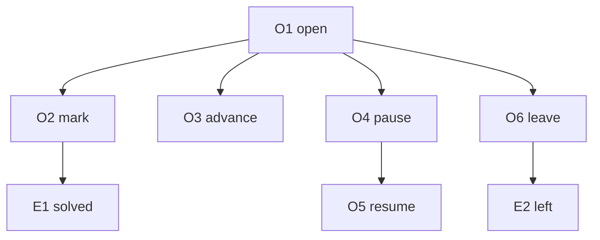

# Contract: Attempt

Authoring rules: [`.agents/specs/rules/technical/contracts.md`](../../../.agents/specs/rules/technical/contracts.md).

- **Kind**: API
- **Provider**: [`CMP-attempt`](../components/attempt.md)
- **Consumers**: [`CMP-shell`](../components/shell.md)
- **Serves**: Open, mark, pause, leave, and solve ([`loops/solve.md`](../../design/loops/solve.md))
- **Informed by**: [`game-state.md`](../../design/game-state.md)
- **ADRs**: [ADR-0001](../../adr/decisions/0001-godot-gdscript.md)

## Operations

| ID | Name | Input | Output / effect | When |
|----|------|-------|-----------------|------|
| O1 | open | Puzzle id | Loads the definition and progress. Starts get-set-ready | Gallery opens a puzzle |
| O2 | mark | Row, column, and fill, cross, or clear | Updates the grid when marks are allowed and the puzzle is not paused. Returns the grid and line status | During play |
| O3 | advance | Elapsed amount to add | Adds to elapsed when marks are allowed and the puzzle is not paused | Puzzle screen is showing |
| O4 | pause | None | Sets paused, freezes elapsed, blocks marks, and commits marks and elapsed | Settings opened from the puzzle |
| O5 | resume | None | Clears paused | Back from settings to the puzzle |
| O6 | leave | None | Commits in-progress marks and elapsed, then clears the open attempt | Leave to the gallery |

## Events

| ID | Name | Payload | When emitted | Who may subscribe |
|----|------|---------|--------------|-------------------|
| E1 | solved | Puzzle id and elapsed | The fill set matches after a mark | [`CMP-shell`](../components/shell.md) |
| E2 | left | Puzzle id | Leave finished | [`CMP-shell`](../components/shell.md) |

## Guarantees

| ID | Guarantee |
|----|-----------|
| G1 | A mark or advance while marks are blocked or the puzzle is paused changes nothing |
| G2 | A successful mark returns the grid and the line status together |
| G3 | Open of an unknown id changes nothing |

## Errors

| Condition | Result |
|-----------|--------|
| Marks blocked, or paused | No change |
| Unknown puzzle id | No change |

## Diagram

