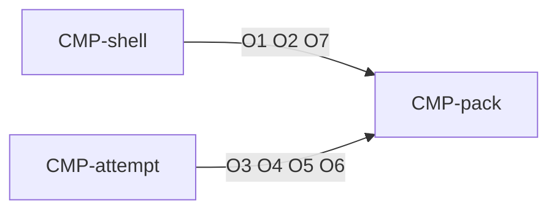

# Contract: Pack

Authoring rules: [`.agents/specs/rules/technical/contracts.md`](../../../.agents/specs/rules/technical/contracts.md).

- **Kind**: API
- **Provider**: [`CMP-pack`](../components/pack.md)
- **Consumers**: [`CMP-shell`](../components/shell.md), [`CMP-attempt`](../components/attempt.md)
- **Serves**: Gallery listing, free-order progress, solve, and gallery reset ([`progression.md`](../../design/progression.md), [`end-conditions.md`](../../design/end-conditions.md))
- **Informed by**: [`entities/puzzle.md`](../../design/entities/puzzle.md), [`persistence.md`](../persistence.md)
- **ADRs**: [ADR-0002](../../adr/decisions/0002-user-data-dir.md)

## Operations

| ID | Name | Input | Output / effect | When |
|----|------|-------|-----------------|------|
| O1 | list | None | Id, size, ever-completed, attempt status, personal best, and whether the thumbnail is visible, for each puzzle | Gallery |
| O2 | completion-rate | None | Ever-completed count ÷ 200 | Gallery |
| O3 | definition | Puzzle id | Size, clues, solution fills, generated picture id, and pixel picture id | Open |
| O4 | progress | Puzzle id | The progress record | Open |
| O5 | commit | Puzzle id, marks, elapsed, and attempt status | Replaces that record and the progress file | When marks or attempt status change, on pause, and on leave |
| O6 | record-solve | Puzzle id and elapsed | Sets ever-completed, clears the attempt, and replaces personal best only when the time is shorter | Solve |
| O7 | reset | Puzzle id | Clears marks, elapsed, personal best, and ever-completed. Attempt becomes not started | Gallery reset |

## Events

None — callers receive the return value.

## Guarantees

| ID | Guarantee |
|----|-----------|
| G1 | Personal best never increases while set |
| G2 | An unknown id changes nothing |
| G3 | O5, O6, and O7 replace `user://progress.cfg`. A failed write leaves the previous file |

## Errors

| Condition | Result |
|-----------|--------|
| Unknown puzzle id | No change |

## Diagram

