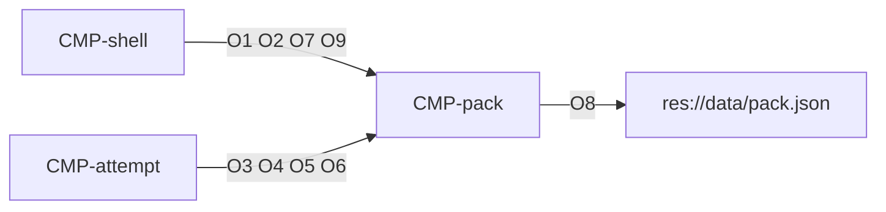

# Contract: Pack

Authoring rules: [`.agents/specs/rules/technical/contracts.md`](../../../.agents/specs/rules/technical/contracts.md).

- **Kind**: API
- **Provider**: [`CMP-pack`](../components/pack.md)
- **Consumers**: [`CMP-shell`](../components/shell.md), [`CMP-attempt`](../components/attempt.md)
- **Serves**: Gallery listing, free-order progress, solve, and gallery reset ([`progression.md`](../../design/progression.md), [`end-conditions.md`](../../design/end-conditions.md))
- **Informed by**: [`entities/puzzle.md`](../../design/entities/puzzle.md), [`persistence.md`](../persistence.md)
- **ADRs**: [ADR-0002](../../adr/decisions/0002-user-data-dir.md)

## Operations

| ID | Name | Input | Output / effect | When |
|----|------|-------|-----------------|------|
| O1 | list | None | Id, size, ever-completed, attempt status, personal best, hint-free, thumbnail visible | Gallery |
| O2 | completion-rate | None | Ever-completed count ÷ 200; finished at 1 | Gallery |
| O3 | definition | Puzzle id | Size, clues, solution fills, picture ids | Open |
| O4 | progress | Puzzle id | The progress record | Open |
| O5 | commit | Puzzle id, marks, elapsed, attempt status | Replaces that record and the progress file | Marks / pause / leave |
| O6 | record-solve | Puzzle id, elapsed, hint-free-eligible | Ever-completed; hint-free from eligibility; clear attempt; PB if shorter | Solve |
| O7 | reset | Puzzle id | Clear marks, elapsed, PB, ever-completed, hint-free; attempt not started | Gallery reset |
| O8 | load-pack | Pack path | Validate into [`SCH-puzzle-def`](../schemata/puzzle-def.md); return count and rejects | Pack start |
| O9 | void-hint-free | Puzzle id | Clear hint-free; replace progress file | Hint enable while attempt active |

## Pack layout

One JSON file at `res://data/pack.json`: UTF-8 array keyed by [`SCH-puzzle-def`](../schemata/puzzle-def.md) fields ([ADR-0003](../../adr/decisions/0003-catalog-asset-roots.md)).

## Events

None — callers receive the return value.

## Guarantees

| ID | Guarantee |
|----|-----------|
| G1 | Personal best never increases while set |
| G2 | An unknown id changes nothing |
| G3 | O5, O6, O7, and O9 replace `user://progress.cfg`; failed write leaves the previous file |
| G4 | O8 loads once at pack start; a rejected entry never reaches O1 or O3 |
| G5 | Accept when [`SCH-puzzle-def`](../schemata/puzzle-def.md) I1–I5 hold and no earlier entry shares F1, F6, or F7; entry order wins conflicts |

## Errors

| Condition | Result |
|-----------|--------|
| Unknown puzzle id | No change |
| O8: missing or invalid JSON | Empty pack; error logged with path |
| O8: bad or duplicate F1/F6/F7 entry | Reject that entry; rest still load |

## Diagram

## Verification

Seam S6 ([`verification.md`](../verification.md)): O8 and `SCH-puzzle-def` in headless GUT; I12 is the unit assertion.
