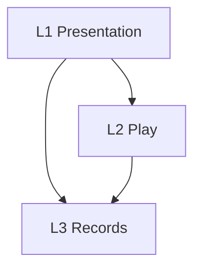

# Layers

Authoring rules: [`.agents/specs/rules/technical/layers.md`](../../.agents/specs/rules/technical/layers.md).

- **Serves**: Calm tactile grid, Snappy solve, and the local pack ([`vision.md`](../vision.md), [`definition.md`](../definition/definition.md)).
- **Informed by**: [ADR-0001](../adr/decisions/0001-godot-gdscript.md), [ADR-0004](../adr/decisions/0004-shell-attempt-rules-pack.md), [`design.md`](../design/design.md), [`ux.md`](../ux/ux.md)

## Layers

| ID | Layer | Responsibility | May depend on |
|----|-------|----------------|---------------|
| L1 | Presentation | Screens, input, drawing, audio, and haptics | L2, L3 |
| L2 | Play | Open attempt, marks, timer, pause, and rule checks | L3 |
| L3 | Records | Pack definitions and durable per-puzzle progress | none |

## Dependency rules

| ID | Rule |
|----|------|
| D1 | A layer calls only a higher layer id, or stays inside itself |
| D2 | L3 calls neither L1 nor L2 |
| D3 | The dependency graph has no cycles |

## Diagram

