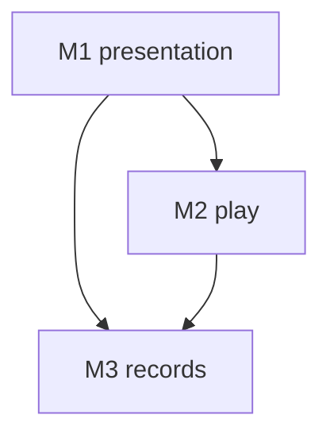

# Modules

Authoring rules: [`.agents/specs/rules/technical/modules.md`](../../.agents/specs/rules/technical/modules.md).

- **Serves**: Calm tactile grid, Snappy solve, and the local pack ([`vision.md`](../vision.md), [`definition.md`](../definition/definition.md)).
- **Informed by**: [ADR-0001](../adr/decisions/0001-godot-gdscript.md), [`layers.md`](layers.md)

## Modules

| ID | Module | Contains | Boundary |
|----|--------|----------|----------|
| M1 | presentation | [`CMP-shell`](components/shell.md) | Screens, input, drawing, and playback |
| M2 | play | [`CMP-attempt`](components/attempt.md), [`CMP-rules`](components/rules.md) | Attempt state and pure checks |
| M3 | records | [`CMP-pack`](components/pack.md) | Definitions and progress |

## Boundaries

| ID | From | To | Allowed | Forbidden |
|----|------|----|---------|-----------|
| B1 | M1 | M2 | [`CTR-attempt`](contracts/attempt.md) | M1 writing marks or progress |
| B2 | M1 | M3 | [`CTR-pack`](contracts/pack.md) list, completion rate, reset, and both picture ids | M1 writing progress fields |
| B3 | M2 | M3 | [`CTR-pack`](contracts/pack.md) definition, progress, commit, and record-solve | M3 calling M1 or M2 |
| B4 | CMP-attempt | CMP-rules | [`CTR-rules`](contracts/rules.md) | CMP-rules writing state |

## Diagram

