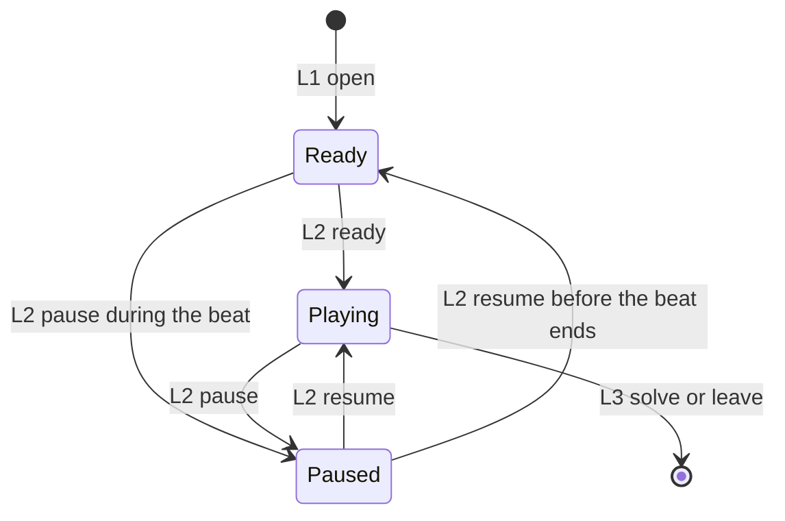

# Schema: Attempt

Authoring rules: [`.agents/specs/rules/technical/schemata.md`](../../../.agents/specs/rules/technical/schemata.md).

- **Kind**: entity
- **Owner**: [`CMP-attempt`](../components/attempt.md)
- **Serves**: The open attempt ([`game-state.md`](../../design/game-state.md))
- **Informed by**: [`loops/solve.md`](../../design/loops/solve.md), [`game-state/fields.md`](../../design/game-state/fields.md)
- **ADRs**: [ADR-0001](../../adr/decisions/0001-godot-gdscript.md)

## Fields

| ID | Field | Type / shape | Required | Notes |
|----|-------|--------------|----------|-------|
| F1 | puzzle-id | Puzzle id, or none | required | Session selection |
| F2 | marks | [`SCH-mark-grid`](mark-grid.md) | required while a puzzle is open | Player marks |
| F3 | elapsed | The attempt's elapsed value, ≥ 0 | required | Same value the timer shows |
| F4 | paused | Boolean | required | Settings cover from the puzzle |
| F5 | marks-allowed | Boolean | required | False during get-set-ready and while paused |

## Invariants

| ID | Invariant |
|----|-----------|
| I1 | Line error, satisfied clues, and solved are computed and are not fields |
| I2 | While F5 is false or F4 is true, mark operations change nothing |

## Lifecycle

| ID | Phase | Who | What changes |
|----|-------|-----|--------------|
| L1 | create | [`CMP-attempt`](../components/attempt.md) | Open loads progress and starts get-set-ready with marks blocked |
| L2 | update | [`CMP-attempt`](../components/attempt.md) | Ready completes, marks, ticks, pause, and resume |
| L3 | destroy | [`CMP-attempt`](../components/attempt.md) | Solve or leave clears the open attempt after the pack update |

## Relationships

| Related schema | Cardinality | Notes |
|----------------|-------------|-------|
| [`SCH-puzzle-def`](puzzle-def.md) | one while open | F1 |
| [`SCH-mark-grid`](mark-grid.md) | one | F2 |

## Diagram

## Persistence

N/A — rebuilt from [`SCH-progress`](progress.md). Pause and marks-allowed are not stored.
