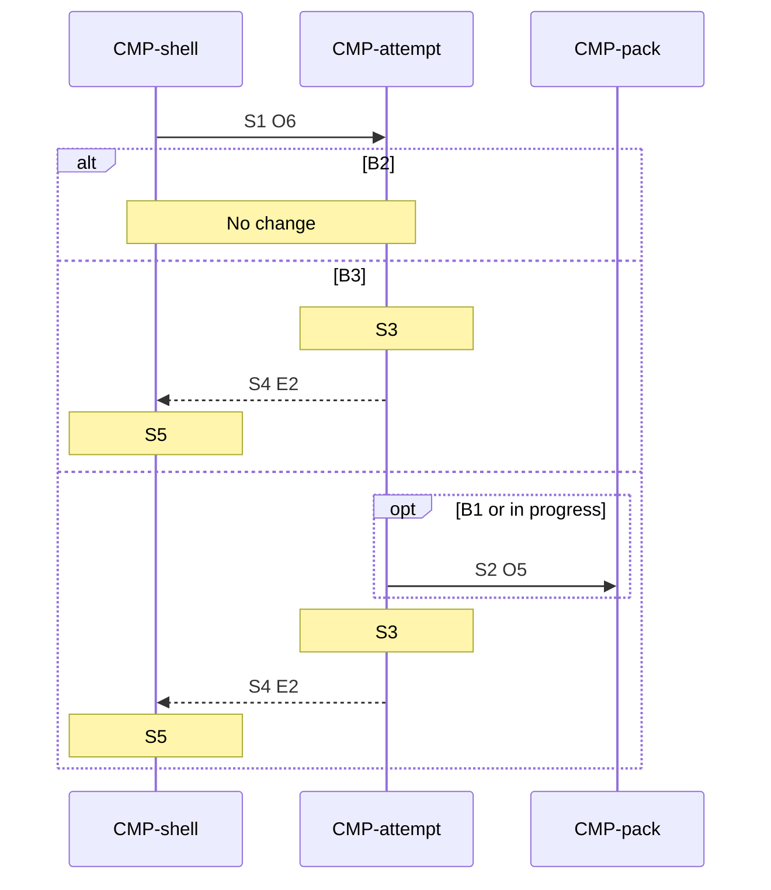

# Sequence: Leave

Authoring rules: [`.agents/specs/rules/technical/sequences.md`](../../../.agents/specs/rules/technical/sequences.md).

- **Trigger**: Puzzle Leave (`UI-puzzle.C1` / `IN.back`) while an attempt is open.
- **Participants**: [`CMP-shell`](../components/shell.md), [`CMP-attempt`](../components/attempt.md), [`CMP-pack`](../components/pack.md)
- **Contracts used**: [`CTR-attempt`](../contracts/attempt.md), [`CTR-pack`](../contracts/pack.md)
- **Serves**: Calm leave to gallery ([`END.O1`](../../design/end-conditions.md), [`L-solve.K6`](../../design/loops/solve.md))
- **Informed by**: [`journeys/leave-resume.md`](../../ux/journeys/leave-resume.md), [`screens/puzzle.md`](../../ux/screens/puzzle.md), [`SAV.M1`](../persistence.md)
- **ADRs**: [ADR-0001](../../adr/decisions/0001-godot-gdscript.md), [ADR-0002](../../adr/decisions/0002-user-data-dir.md)

## Steps

| ID | From | To | Via | Action / message |
|----|------|----|-----|------------------|
| S1 | CMP-shell | CMP-attempt | CTR-attempt.O6 | Leave |
| S2 | CMP-attempt | CMP-pack | CTR-pack.O5 | Commit marks, elapsed, and attempt status when there is something to persist |
| S3 | CMP-attempt | CMP-attempt | internal | Clear pause and the open attempt |
| S4 | CMP-attempt | CMP-shell | CTR-attempt.E2 | Left, with the puzzle id |
| S5 | CMP-shell | CMP-shell | internal | Show the gallery |

## Branches

| ID | Condition | Next steps | Outcome |
|----|-----------|------------|---------|
| B1 | Leave during get-set-ready | S2 | No auto-cross. Commit restored marks and elapsed as held; then S3–S5 |
| B2 | No open attempt at S1 | None | No change. The current screen stays |
| B3 | Attempt not started and nothing to persist | S3 | Skip S2. Clear the attempt and show the gallery |

## Postconditions

- The gallery is showing.
- The open attempt is cleared.
- When S2 ran, `user://progress.cfg` holds the left puzzle's marks, elapsed, and attempt status.
- Resume is [`open.md`](open.md) for that puzzle id.

## Diagram

