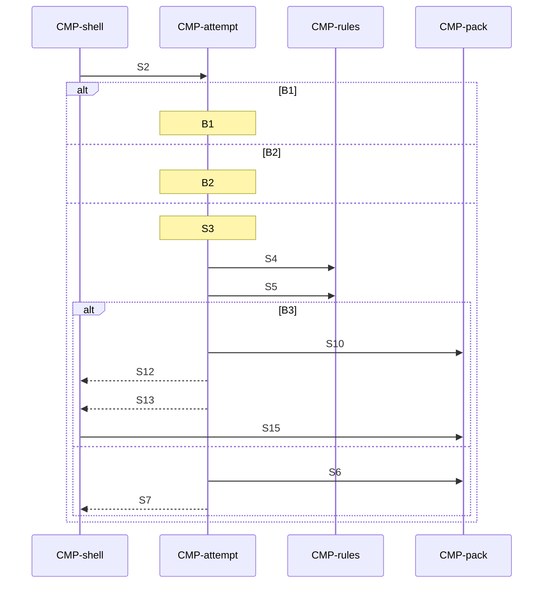

# Sequence: Mark

Authoring rules: [`.agents/specs/rules/technical/sequences.md`](../../../.agents/specs/rules/technical/sequences.md).

- **Trigger**: One cell on an open puzzle. The shell resolves the gesture and calls mark. Tap toggles Fill or Cross off when it is already set. Drag paints each cell once, in order, and stops on solve.
- **Participants**: [`CMP-shell`](../components/shell.md), [`CMP-attempt`](../components/attempt.md), [`CMP-rules`](../components/rules.md), [`CMP-pack`](../components/pack.md)
- **Contracts used**: [`CTR-attempt`](../contracts/attempt.md), [`CTR-rules`](../contracts/rules.md), [`CTR-pack`](../contracts/pack.md)
- **Serves**: Marking and the solve check ([`L-solve.K2`](../../design/loops/solve.md)–[`L-solve.K4`](../../design/loops/solve.md), [`END.W1`](../../design/end-conditions.md))
- **Informed by**: [`controls.md`](../../ux/controls.md), [`sound.md`](../../aesthetics/sound.md), [`haptics.md`](../../view/haptics.md), [`screens/result.md`](../../ux/screens/result.md)
- **ADRs**: [ADR-0001](../../adr/decisions/0001-godot-gdscript.md), [ADR-0002](../../adr/decisions/0002-user-data-dir.md)

## Steps

| ID | From | To | Via | Action / message |
|----|------|----|-----|------------------|
| S1 | CMP-shell | CMP-shell | internal | Resolve one cell and one mark |
| S2 | CMP-shell | CMP-attempt | CTR-attempt.O2 | Mark that cell |
| S3 | CMP-attempt | CMP-attempt | internal | Write it. A first fill or cross sets in progress and keeps ever-completed. None left sets not started and elapsed 0 |
| S4 | CMP-attempt | CMP-rules | CTR-rules.O2 | Line status |
| S5 | CMP-attempt | CMP-rules | CTR-rules.O1 | Fill-set match. Crosses are ignored |
| S6 | CMP-attempt | CMP-pack | CTR-pack.O5 | Commit changed marks or status |
| S7 | CMP-attempt | CMP-shell | CTR-attempt.O2 | Return the grid and line status |
| S8 | CMP-shell | CMP-shell | internal | Matching mark tick ([`SND.X1`](../../aesthetics/sound.md) fill, [`X2`](../../aesthetics/sound.md) cross, [`X3`](../../aesthetics/sound.md) clear). Haptic click when the cell is fill or cross and haptics are on |
| S9 | CMP-attempt | CMP-attempt | internal | Stop elapsed |
| S10 | CMP-attempt | CMP-pack | CTR-pack.O6 | Record the solve at that elapsed |
| S11 | CMP-attempt | CMP-attempt | internal | Clear the open attempt |
| S12 | CMP-attempt | CMP-shell | CTR-attempt.O2 | Return the pre-clear grid and line status |
| S13 | CMP-attempt | CMP-shell | CTR-attempt.E1 | Solved, with the puzzle id and stopped elapsed |
| S14 | CMP-shell | CMP-shell | internal | Sting and open the result screen |
| S15 | CMP-shell | CMP-pack | CTR-pack.O3 | Both picture ids; request both |

## Branches

| ID | Condition | Next steps | Outcome |
|----|-----------|------------|---------|
| B1 | Marks blocked or paused at S2 | None | No change |
| B2 | Cell already has that mark at S3 | None | No tick, haptic, save, or solve check |
| B3 | Fill set matches at S5 | S9 | Skip S6–S8. The result screen opens and the morph runs there |

## Postconditions

- The cell shows the new mark and the shell has the line status.
- The progress file is written.

## Diagram

