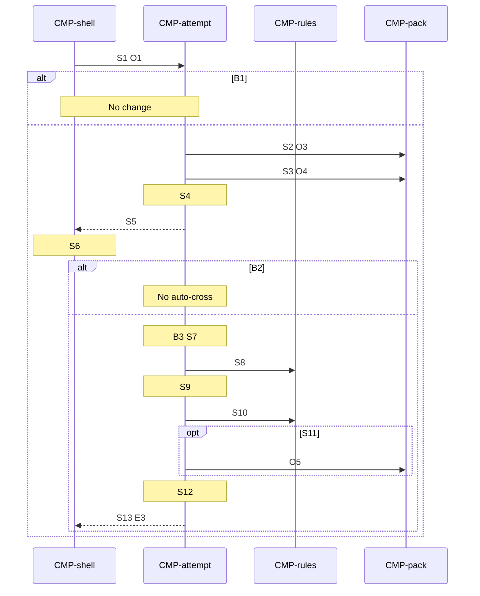

# Sequence: Open

Authoring rules: [`.agents/specs/rules/technical/sequences.md`](../../../.agents/specs/rules/technical/sequences.md).

- **Trigger**: The gallery opens a puzzle.
- **Participants**: [`CMP-shell`](../components/shell.md), [`CMP-attempt`](../components/attempt.md), [`CMP-rules`](../components/rules.md), [`CMP-pack`](../components/pack.md)
- **Contracts used**: [`CTR-attempt`](../contracts/attempt.md), [`CTR-rules`](../contracts/rules.md), [`CTR-pack`](../contracts/pack.md)
- **Serves**: Ready on the solve loop ([`L-solve.K1`](../../design/loops/solve.md))
- **Informed by**: [`screens/puzzle.md`](../../ux/screens/puzzle.md) S2, [`CMP-attempt.R2`](../components/attempt.md), [`SAV.M1`](../persistence.md)
- **ADRs**: [ADR-0001](../../adr/decisions/0001-godot-gdscript.md), [ADR-0002](../../adr/decisions/0002-user-data-dir.md)

## Steps

| ID | From | To | Via | Action / message |
|----|------|----|-----|------------------|
| S1 | CMP-shell | CMP-attempt | CTR-attempt.O1 | Open with the puzzle id |
| S2 | CMP-attempt | CMP-pack | CTR-pack.O3 | Load the definition |
| S3 | CMP-attempt | CMP-pack | CTR-pack.O4 | Load progress |
| S4 | CMP-attempt | CMP-attempt | internal | Marks blocked, not paused. Progress supplies marks and elapsed. Not started is clear and 0 |
| S5 | CMP-attempt | CMP-shell | CTR-attempt.O1 | Return the grid and elapsed. Get-set-ready started |
| S6 | CMP-shell | CMP-shell | internal | Show the puzzle screen and the Ready beat |
| S7 | CMP-attempt | CMP-attempt | internal | The beat ends |
| S8 | CMP-attempt | CMP-rules | CTR-rules.O3 | Empty-line auto-cross cells |
| S9 | CMP-attempt | CMP-attempt | internal | Write those crosses. A cross sets in progress |
| S10 | CMP-attempt | CMP-rules | CTR-rules.O2 | Line status |
| S11 | CMP-attempt | CMP-pack | CTR-pack.O5 | Commit if marks or status changed |
| S12 | CMP-attempt | CMP-attempt | internal | Allow marks when not paused. Elapsed ticks only then |
| S13 | CMP-attempt | CMP-shell | CTR-attempt.E3 | Ready: puzzle id, grid, and line status |

## Branches

| ID | Condition | Next steps | Outcome |
|----|-----------|------------|---------|
| B1 | Unknown puzzle id at S1 | None | No change. The gallery stays |
| B2 | Leave before the beat ends | None | No auto-cross. Hand off to [`leave.md`](leave.md) B1 |
| B3 | Pause during the beat | S7 | The beat continues. Auto-cross waits for S7. Marks stay blocked until then, and while paused |

## Postconditions

- The puzzle screen is showing.
- The attempt holds loaded marks, any auto-cross, and restored elapsed.
- The shell has the grid and line status from S13.
- Marks are allowed when S7 has passed and the puzzle is not paused.
- The progress file changes only if auto-cross changed marks or status.

## Diagram

