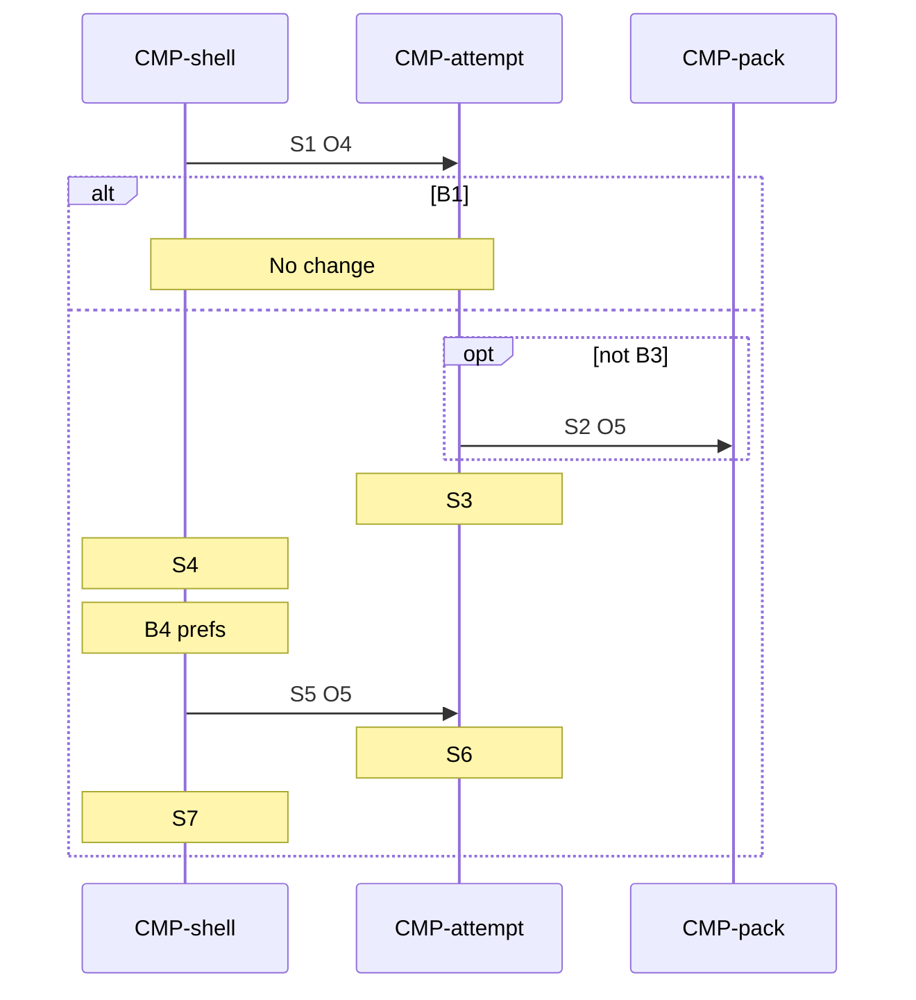

# Sequence: Pause

Authoring rules: [`.agents/specs/rules/technical/sequences.md`](../../../.agents/specs/rules/technical/sequences.md).

- **Trigger**: Pause — `IN.pause` / `UI-puzzle.C6` while an attempt is open. Resume — `UI-settings.C3` when settings opened from that pause.
- **Participants**: [`CMP-shell`](../components/shell.md), [`CMP-attempt`](../components/attempt.md), [`CMP-pack`](../components/pack.md)
- **Contracts used**: [`CTR-attempt`](../contracts/attempt.md), [`CTR-pack`](../contracts/pack.md)
- **Serves**: Pause without quitting ([`L-solve.K5`](../../design/loops/solve.md), [`GS.paused`](../../design/game-state.md))
- **Informed by**: [`screens/puzzle.md`](../../ux/screens/puzzle.md), [`screens/settings.md`](../../ux/screens/settings.md), [`navigation.md`](../../ux/navigation.md) T7–T8, [`SAV.M1`](../persistence.md)
- **ADRs**: [ADR-0001](../../adr/decisions/0001-godot-gdscript.md), [ADR-0002](../../adr/decisions/0002-user-data-dir.md)

## Steps

| ID | From | To | Via | Action / message |
|----|------|----|-----|------------------|
| S1 | CMP-shell | CMP-attempt | CTR-attempt.O4 | Pause |
| S2 | CMP-attempt | CMP-pack | CTR-pack.O5 | Commit marks, elapsed, and attempt status when there is something to persist |
| S3 | CMP-attempt | CMP-attempt | internal | Set paused; freeze elapsed; block marks |
| S4 | CMP-shell | CMP-shell | internal | Show settings |
| S5 | CMP-shell | CMP-attempt | CTR-attempt.O5 | Resume |
| S6 | CMP-attempt | CMP-attempt | internal | Clear paused. Marks allowed only if get-set-ready has finished |
| S7 | CMP-shell | CMP-shell | internal | Show the puzzle |

## Branches

| ID | Condition | Next steps | Outcome |
|----|-----------|------------|---------|
| B1 | No open attempt at S1 | None | No change. Gallery Settings is not this sequence |
| B2 | Pause during get-set-ready | S2 | Commit as held; then S3–S4. The Ready beat continues; auto-cross waits on [`open.md`](open.md) S7 |
| B3 | Nothing to persist at S2 | S3 | Skip S2. Still pause and show settings |
| B4 | Pref toggles on settings | — | Shell-only ([`SCH-preferences`](../schemata/preferences.md)); not steps here |

## Postconditions

- After S4: settings is showing; the attempt is open and paused; elapsed does not tick; marks are blocked.
- After S7: the puzzle is showing; paused is false; marks follow get-set-ready and pause rules.
- When S2 ran, `user://progress.cfg` holds marks, elapsed, and attempt status.

## Diagram

