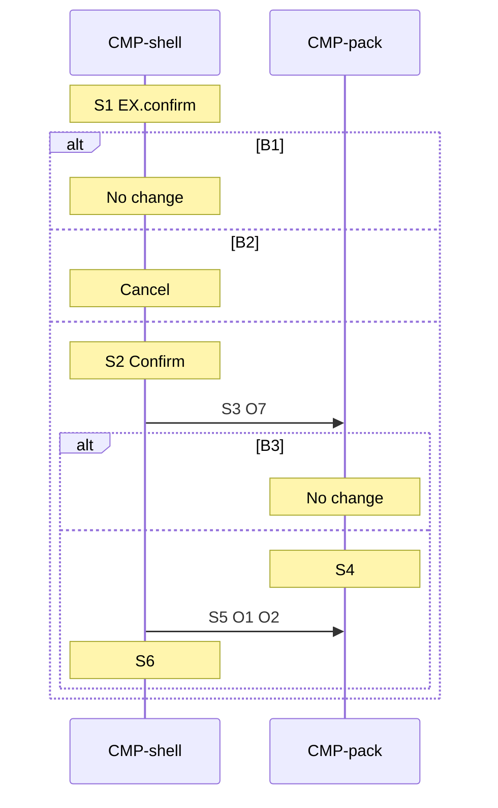

# Sequence: Reset

Authoring rules: [`.agents/specs/rules/technical/sequences.md`](../../../.agents/specs/rules/technical/sequences.md).

- **Trigger**: Confirm on `EX.confirm` after gallery Reset (`UI-gallery.C2`) when ever-completed or in progress.
- **Participants**: [`CMP-shell`](../components/shell.md), [`CMP-pack`](../components/pack.md)
- **Contracts used**: [`CTR-pack`](../contracts/pack.md)
- **Serves**: Gallery reset as new ([`END.O2`](../../design/end-conditions.md), [`PRG.M1`](../../design/progression.md))
- **Informed by**: [`journeys/gallery-reset.md`](../../ux/journeys/gallery-reset.md), [`screens/gallery.md`](../../ux/screens/gallery.md), [`exceptions.md`](../../ux/exceptions.md), [`SAV.M1`](../persistence.md)
- **ADRs**: [ADR-0001](../../adr/decisions/0001-godot-gdscript.md), [ADR-0002](../../adr/decisions/0002-user-data-dir.md)

## Steps

| ID | From | To | Via | Action / message |
|----|------|----|-----|------------------|
| S1 | CMP-shell | CMP-shell | internal | Show `EX.confirm` after Reset when allowed |
| S2 | CMP-shell | CMP-shell | internal | Confirm |
| S3 | CMP-shell | CMP-pack | CTR-pack.O7 | Reset with the puzzle id |
| S4 | CMP-pack | CMP-pack | internal | Clear marks, elapsed, personal best, and ever-completed; attempt → not started; replace `user://progress.cfg` |
| S5 | CMP-shell | CMP-pack | CTR-pack.O1, O2 | Refresh list and completion rate |
| S6 | CMP-shell | CMP-shell | internal | Dismiss confirm; gallery Default |

## Branches

| ID | Condition | Next steps | Outcome |
|----|-----------|------------|---------|
| B1 | Reset not allowed at S1 | None | No change. Confirm does not open |
| B2 | Cancel on `EX.confirm` | None | Dismiss confirm. No `O7` |
| B3 | Unknown puzzle id at S3 | None | No change ([`CTR-pack.G2`](../contracts/pack.md)) |

## Postconditions

- The gallery is in Default.
- That puzzle is new: not started, no marks, elapsed 0, no personal best, not ever-completed.
- `user://progress.cfg` holds that cleared record when S4 ran.
- Completion rate and the tile match the cleared record.

## Diagram

